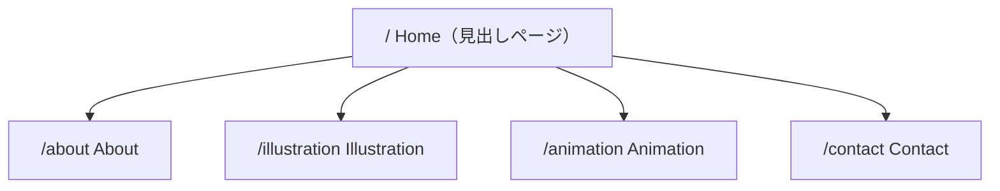

# ポートフォリオサイト 設計書

- 作成日: 2026-09-14
- 対象: `2026_0913_PortFolioKota`
- 参照素材: `Sorcepronpts/*.txt`（21st.dev 形式のコンポーネントプロンプト）
- 本書の位置づけ: **実装の骨組み（構造・動き・手順）を定義する設計図**。実装はこの設計書に従って段階的に進める。

---

## 1. 確定事項（ヒアリング結果）

| 項目 | 決定内容 |
|---|---|
| 技術スタック | Next.js (App Router) + TypeScript + Tailwind CSS + shadcn/ui |
| アニメーション | `motion`（旧 framer-motion） |
| ページ構成 | Home（見出し）→ About / Illustration / Animation / Contact |
| ナビ項目 | Home / About / Illustration / Animation / Contact（英語表記） |
| Header | Header.txt の RandomLetterSwap ナビ。**本体コード `random-letter-swap` は後日 `Sorcepronpts/` に追加される（提供待ち）** |
| Footer | footer.txt の AnimatedDock。リンク先は SNS（URL は後で差し替え） |
| Home の構成 | 上から Hero → 融合セクション（scroll + scroll01）→ 浮遊セクション（Illustrater） |
| 融合セクションの動き | **スクロール連動のみ**（ホバー散開なし）。最初は写真が重なったスタック → スクロールで散開・3カラム整列 → scroll.txt のように左右にずれて流れる |
| 浮遊セクションの役割 | **Illustration ページへの導線専用** |
| 画像素材 | まずプレースホルダー。後で差し替えやすい構造にする |
| カラーテーマ | ライトテーマ（白基調） |
| 作成手順 | 先に Home（見出しページ）のみ完成 → その後 各下層ページを 1 つずつ作成 |

---

## 2. サイト構成（情報設計）

### 2.1 ページ階層



- サイトを開くと必ず `/`（Home）が表示される。
- 各ページへは **Header のナビ**（全ページ共通）から遷移できる。
- Home 最下部の浮遊セクションは **Illustration ページ専用の導線**として機能する。
- すべてのページは **Header（上部）＋ページ本体＋Footer（下部）** の 3 層構造。

### 2.2 URL 設計

| ページ | パス | ファイル |
|---|---|---|
| Home | `/` | `app/page.tsx` |
| About | `/about` | `app/about/page.tsx` |
| Illustration | `/illustration` | `app/illustration/page.tsx` |
| Animation | `/animation` | `app/animation/page.tsx` |
| Contact | `/contact` | `app/contact/page.tsx` |

---

## 3. 技術スタック詳細

| 分類 | 採用 | 備考 |
|---|---|---|
| フレームワーク | Next.js 15 系（App Router） | `create-next-app` で生成 |
| 言語 | TypeScript | strict |
| スタイル | Tailwind CSS v4 + shadcn/ui | `components/ui` 配下に参照コンポーネントを配置 |
| アニメーション | `motion`（`motion/react`） | 参照ファイル内の `framer-motion` import はすべて `motion/react` に統一する（API 互換） |
| アイコン | `lucide-react` | Footer / About / Contact で使用 |
| ユーティリティ | `clsx`, `tailwind-merge` | `lib/utils.ts` の `cn()` |
| 画像 | `next/image` | プレースホルダー期間は `remotePatterns` で外部 URL を許可。実素材は `public/images/` へ |

### 依存パッケージ（初期インストール）

```bash
npx create-next-app@latest portfolio --typescript --tailwind --eslint --app --src-dir=false
npx shadcn@latest init
npx shadcn@latest add button
npm i motion lucide-react clsx tailwind-merge
```

---

## 4. ディレクトリ構成

```
portfolio/
├─ app/
│  ├─ layout.tsx              # 共通レイアウト（Header / Footer をここで配置）
│  ├─ globals.css             # Tailwind + shadcn テーマ変数（ライト）
│  ├─ page.tsx                # Home（見出しページ）
│  ├─ about/page.tsx
│  ├─ illustration/page.tsx
│  ├─ animation/page.tsx
│  └─ contact/page.tsx
│
├─ components/
│  ├─ layout/
│  │  ├─ header.tsx           # Header.txt ベース（サイトロゴ + RandomLetterSwap ナビ）
│  │  └─ footer.tsx           # footer.txt ベース（AnimatedDock + コピーライト）
│  ├─ home/
│  │  ├─ hero.tsx             # Hero.txt ベース
│  │  ├─ scroll-stack-grid.tsx # ★ scroll.txt + scroll01.txt 融合セクション（新規設計）
│  │  └─ floating-gateway.tsx # Illustrater.txt ベース（/illustration への導線）
│  └─ ui/                     # shadcn + 参照コンポーネント原本
│     ├─ button.tsx           # shadcn
│     ├─ random-letter-swap.tsx   # ※提供待ち（Sorcepronpts に追加予定）
│     ├─ animated-dock.tsx        # footer.txt
│     ├─ parallax-floating.tsx    # Illustrater.txt
│     ├─ profile-card.tsx         # AboutPage.txt
│     ├─ shared-element-gallery.tsx # illustraterpage.txt
│     ├─ scroll-expansion-hero.tsx  # Animationpage.txt
│     └─ contact-page.tsx         # Contactpage.txt
│
├─ hooks/
│  └─ use-mouse-position-ref.ts   # Illustrater.txt 付属フック
│
├─ lib/
│  ├─ utils.ts                # cn()
│  ├─ site-config.ts          # サイト名 / ナビ定義 / SNS リンク（差し替えポイント）
│  └─ images.ts               # 画像リスト定義（プレースホルダー → 実素材へ差し替えポイント）
│
├─ public/
│  └─ images/
│     ├─ hero/
│     ├─ stack/               # 融合セクション用
│     ├─ floating/            # 浮遊セクション用
│     ├─ illustration/
│     └─ animation/
│
└─ Sorcepronpts/              # 参照プロンプト（既存）
```

---

## 5. 共通レイアウト

### 5.1 Header（`components/layout/header.tsx`）

- 参照: `Sorcepronpts/Header.txt`
- 配置: `position: fixed; top: 0`、全ページ共通で `app/layout.tsx` に置く。
- 構成:
  - 左: サイトロゴ（テキスト。`site-config.ts` の `siteName`）→ `/` へリンク
  - 右: ナビ `Home / About / Illustration / Animation / Contact`
- 各ナビ項目は `RandomLetterSwap` でラップし、`next/link` で遷移。
  - `staggerDuration={0.025}`, `transition={{ duration: 0.6, type: "spring" }}`（参照値をそのまま採用）
- 背景: 初期は透明。スクロール量 > 0 で `backdrop-blur` + 半透明白（ライトテーマ）に切り替え。
- 現在ページのナビ項目は `text-foreground`、それ以外は `text-muted-foreground`。
- レスポンシブ: `sm` 未満は文字サイズとギャップを縮小して横並びを維持（ハンバーガーメニューは今回スコープ外・未確定事項へ）。
- **依存**: `@/components/ui/random-letter-swap` は提供待ち。到着まで Header はプレーンな `<Link>` で仮実装し、到着後に差し替える。

### 5.2 Footer（`components/layout/footer.tsx`）

- 参照: `Sorcepronpts/footer.txt`
- 配置: 各ページ最下部。`app/layout.tsx` に置く。
- 構成:
  - 中央: `AnimatedDock`（マウス距離でアイコンが拡大するドック）
  - その下: `© {year} {siteName}` の小さなコピーライト
- ドック項目（`site-config.ts` の `socialLinks` から生成）:

| アイコン (lucide) | ラベル | URL |
|---|---|---|
| `Twitter`（X） | X | `#`（後で差し替え） |
| `Instagram` | Instagram | `#`（後で差し替え） |
| `Youtube` | YouTube | `#`（後で差し替え） |
| `Mail` | Mail | `mailto:`（後で差し替え） |

- すべて `target="_blank"` `rel="noopener noreferrer"`。
- 参照コードの `Link` は `next/link` をそのまま使用。

---

## 6. Home（見出しページ）詳細設計

### 6.1 セクション構成（上から順）

```
┌──────────────────────────────┐
│ Header（fixed）              │
├──────────────────────────────┤
│ ① Hero                       │  Hero.txt
│    背景画像パララックス + 見出しテキスト │
├──────────────────────────────┤
│ ② ScrollStackGrid            │  scroll.txt + scroll01.txt 融合（新規）
│    写真スタック → 散開 → グリッド流動 │
├──────────────────────────────┤
│ ③ FloatingGateway            │  Illustrater.txt
│    浮遊画像 + 「Illustration」導線  │
├──────────────────────────────┤
│ Footer                       │
└──────────────────────────────┘
```

### 6.2 ① Hero（`components/home/hero.tsx`）

- 参照: `Sorcepronpts/Hero.txt` の `demo.tsx`（`davincho-hero-1.tsx` のカウンターは不要のため採用しない）
- 高さ: `80vh`、角丸コンテナ（`rounded-4xl`）、白背景
- 動き: `useScroll` + `useTransform` で背景画像を `y: 0% → 10%` にパララックス
- テキスト: `mix-blend-difference` で背景の上に重ねる
  - 右上: サブコピー（小）
  - 左下: メインコピー（大 / `text-[5vw]`）
- **参照からの変更点**:
  - 背景画像コンテナの `fixed` を `absolute` に変更する（後続の sticky セクションと干渉するため）。
  - 画像は `lib/images.ts` の `heroImage` を参照。
  - テキスト内容は未確定（§11 参照）。仮でサイト名 + タグラインを入れる。

### 6.3 ② ScrollStackGrid（`components/home/scroll-stack-grid.tsx`）★新規設計

scroll01.txt（写真スタック）と scroll.txt（パララックスグリッド）を **1 つのスクロール連動コンポーネント**として統合する。

#### 動きの流れ

```
progress 0.0            0.4                      1.0
 │ [Phase A: 展開]      │ [Phase B: 流動]         │
 │ 中央にスタック状に     │ 3カラムのグリッドが      │
 │ 重なった写真が、       │ scroll.txt のように      │
 │ 散らばりながら         │ 左右カラムが外側へ流れ、  │
 │ 3カラムに整列する      │ 傾きながら上へ抜ける      │
```

1. **初期状態（progress = 0）**
   - 全カードが画面中央に重なった **スタック**（scroll01 の非ホバー状態を再現）
   - カード i: `translateY(i * 0.5rem) scale(1 - i * 0.05) rotate(baseRotation[i])`
   - `baseRotation = [2, -2, 4, -4, 6, ...]deg`（scroll01 の `rotate-2 / -rotate-2 / ...` に対応）
   - z-index は先頭が最前面
2. **Phase A: 展開（progress 0 → 0.4）**
   - 各カードがスタック位置から **グリッド上の割当セル位置**へ移動、`scale → 1`、`rotate → 0`
   - セル割当: scroll.txt と同様に画像配列を 3 分割（`first / second / third`）してカラムに振り分け
   - 補間は `useTransform(scrollYProgress, [0, 0.4], [stackX, gridX])` のようにカード毎に定義
3. **Phase B: 流動（progress 0.4 → 1.0）**
   - scroll.txt の `translateYFirst / translateXFirst / rotateXFirst` 等をそのまま適用
     - 第 1 カラム: `y: 0 → -200px`, `x: 0 → -200px`, `rotateZ: 0 → -20deg`
     - 第 2 カラム: 動かない（参照どおり）
     - 第 3 カラム: `y: 0 → -200px`, `x: 0 → +200px`, `rotateZ: 0 → +20deg`
4. セクションを抜けると ③ FloatingGateway が続く。

#### 実装方針

- 外側ラッパー: `relative h-[300vh]`（スクロール距離を確保）
- 内側: `sticky top-0 h-screen overflow-hidden`（ここに全カードを絶対配置）
- `useScroll({ target: wrapperRef, offset: ["start start", "end end"] })` で `scrollYProgress` を取得
- グリッドの目標座標は **コンテナサイズから算出**（`ResizeObserver` でリサイズ対応）
  - 3 カラム: x = 幅の `20% / 50% / 80%`（カード中心）
  - 行: カード高さ + gap で縦に積む
- カード 1 枚は `motion.div` + `next/image`（`h-80 w-64 rounded-xl shadow-lg` を基準）
- 画像枚数: **9 枚**（3 カラム × 3 行）を初期値とする。`lib/images.ts` の `stackImages` で管理
- scroll01 の **ホバー散開・クリック回転は実装しない**（確定事項）
- `prefers-reduced-motion` 時は Phase A/B を省略し、最初からグリッド表示

#### レスポンシブ

| 幅 | カラム | 流動量 |
|---|---|---|
| `lg` 以上 | 3 | 参照値（±200px / ±20deg） |
| `md` | 2 | ±120px / ±12deg |
| `sm` 未満 | 1 | y 方向のみ（x/rotate なし） |

### 6.4 ③ FloatingGateway（`components/home/floating-gateway.tsx`）

- 参照: `Sorcepronpts/Illustrater.txt`（`parallax-floating.tsx` + `use-mouse-position-ref.ts`）
- 役割: **Illustration ページへの導線専用**
- 構成:
  - 背景: ライトテーマに合わせ `bg-black` → `bg-background`（白）に変更
  - 中央: 見出し `Illustration`（参照の "fancy." 部分）+ ボタン `View Works` → `/illustration` へ `next/link`
  - 周囲: `FloatingElement` × 8（参照の配置座標・depth をそのまま採用）
  - 各浮遊画像も `/illustration` へリンク（クリック領域を広げる）
- 動き:
  - マウス位置に応じて `depth` に比例して画像が追従（`sensitivity={-1}`）
  - 初回表示時に画像が `stagger(0.15)` でフェードイン
- 画像は `lib/images.ts` の `floatingImages`（8 枚）から供給

---

## 7. 下層ページ概要（Home 完成後に順次実装）

| ページ | 参照ファイル | コアコンポーネント | 概要 |
|---|---|---|---|
| About | `AboutPage.txt` | `GlassmorphismProfileCard` | アバター・名前・肩書・自己紹介・SNS・「Contact Me」→ `/contact` |
| Illustration | `illustraterpage.txt` | `Gallery / GalleryGrid / GalleryImage` | マソンリーグリッド + クリックで拡大（shared element）・ドラッグで閉じる |
| Animation | `Animationpage.txt` | `ScrollExpandMedia` | スクロールで動画が全画面へ拡張するヒーロー + 作品一覧 |
| Contact | `Contactpage.txt` | `ContactPage` | Email / 所在地 / 電話（コピー機能付き）+ SNS リンク |

- いずれも `app/<page>/page.tsx` に配置し、Header / Footer は `layout.tsx` から自動付与。
- 参照ファイルの `framer-motion` import は `motion/react` に統一。
- 詳細設計は各ページの実装フェーズ着手時に本書へ追記する。

---

## 8. 参照ファイル → 実装 対応表

| 参照ファイル | 使用箇所 | 採用コンポーネント | 参照からの変更点 |
|---|---|---|---|
| `Hero.txt` | Home ① | `demo.tsx` の `Hero` | `fixed` → `absolute`、テキスト差し替え、画像を `images.ts` 参照 |
| `scroll.txt` | Home ② | `ParallaxScrollSecond` のロジック | 固定高コンテナ内スクロール → ページスクロール連動に変更。Phase B の値を流用 |
| `scroll01.txt` | Home ② | `InteractivePhotoStack` の初期スタック表現 | ホバー散開・クリック回転を削除。スタック → グリッドをスクロールで補間 |
| `Illustrater.txt` | Home ③ | `Floating` / `FloatingElement` / `useMousePositionRef` | 黒背景 → 白、中央テキストを Illustration 導線に変更 |
| `Header.txt` | 共通 | `RandomLetterSwapNav` | ナビ項目差し替え、`next/link` 化、fixed 配置。**本体 `random-letter-swap` は提供待ち** |
| `footer.txt` | 共通 | `AnimatedDock` | リンク先を SNS プレースホルダーに |
| `AboutPage.txt` | About | `GlassmorphismProfileCard` | JS → TS 化（型付け） |
| `illustraterpage.txt` | Illustration | `Gallery` 系 | `framer-motion` → `motion/react` |
| `Animationpage.txt` | Animation | `ScrollExpandMedia` | `framer-motion` → `motion/react` |
| `Contactpage.txt` | Contact | `ContactPage` | 連絡先情報をプレースホルダーに |

---

## 9. データ設計（差し替えポイント）

### `lib/site-config.ts`

```ts
export const siteConfig = {
  siteName: "Kota",           // TODO: 確定後に差し替え
  tagline: "",                // TODO: Hero 用コピー
  nav: [
    { label: "Home", href: "/" },
    { label: "About", href: "/about" },
    { label: "Illustration", href: "/illustration" },
    { label: "Animation", href: "/animation" },
    { label: "Contact", href: "/contact" },
  ],
  socialLinks: [
    { id: "x", label: "X", href: "#", icon: "Twitter" },
    { id: "instagram", label: "Instagram", href: "#", icon: "Instagram" },
    { id: "youtube", label: "YouTube", href: "#", icon: "Youtube" },
    { id: "mail", label: "Mail", href: "mailto:", icon: "Mail" },
  ],
};
```

### `lib/images.ts`

```ts
// プレースホルダー期間は picsum.photos（seed 固定）を使用
// 実素材が届いたら public/images/** のパスへ差し替える
export const heroImage = "https://picsum.photos/seed/hero/1920/1200";
export const stackImages = Array.from({ length: 9 }, (_, i) =>
  `https://picsum.photos/seed/stack-${i}/800/1000`);
export const floatingImages = Array.from({ length: 8 }, (_, i) =>
  `https://picsum.photos/seed/float-${i}/600/600`);
```

- `next.config.ts` の `images.remotePatterns` に `picsum.photos` を追加。

---

## 10. 実装手順（フェーズ）

| フェーズ | 内容 | 完了条件 |
|---|---|---|
| **0. 初期化** | Next.js プロジェクト生成、Tailwind / shadcn / motion / lucide 導入、`lib/utils.ts` `site-config.ts` `images.ts` 作成、ライトテーマ設定 | `npm run dev` が起動する |
| **1. Home（見出しページ）** | Header / Footer 実装 → Hero → ScrollStackGrid → FloatingGateway。下層 4 ページは **タイトルのみの仮ページ**を置き、ナビ遷移を確認 | Home が設計どおりに動き、全ページへリンクで遷移できる |
| **2. About** | `AboutPage.txt` を TS 化して配置 | プロフィールカード表示 |
| **3. Illustration** | `illustraterpage.txt` を配置、`images.ts` に `illustrationImages` 追加 | ギャラリー + 拡大表示が動く |
| **4. Animation** | `Animationpage.txt` を配置、動画素材のプレースホルダーを設定 | スクロール拡張ヒーローが動く |
| **5. Contact** | `Contactpage.txt` を配置、連絡先を `site-config.ts` から読む | 連絡先表示 + コピー動作 |
| **6. 仕上げ** | 実素材・SNS URL・コピー差し替え、レスポンシブ調整、`random-letter-swap` 差し替え、デプロイ | 本番公開 |

- **フェーズ 1 が完了するまで下層ページの本実装には着手しない**（確定事項）。
- 各フェーズ着手前に、そのフェーズで必要な未確定事項（§11）を確認する。

---

## 11. 未確定事項（実装前に確認）

| # | 項目 | 影響フェーズ | 現状の仮置き |
|---|---|---|---|
| 1 | サイト名 / 作家名（Header ロゴ・タイトル・コピーライト） | 0 | `Kota` |
| 2 | Hero のメインコピー・サブコピーの文言 | 1 | サイト名 + 空タグライン |
| 3 | `random-letter-swap` 本体コードの提供 | 1 | プレーン `<Link>` で仮実装 |
| 4 | ScrollStackGrid の画像枚数（9 枚で良いか） | 1 | 9 枚 |
| 5 | SNS の実 URL（X / Instagram / YouTube / Mail） | 6 | `#` |
| 6 | モバイルでのハンバーガーメニューの要否 | 6 | 横並び縮小のみ |
| 7 | About の本文・肩書・アバター画像 | 2 | 参照のダミー |
| 8 | Animation ページの動画素材（形式・枚数） | 4 | 参照のダミー |
| 9 | Contact の連絡先（メール・所在地・電話の要否） | 5 | 参照のダミー |
| 10 | デプロイ先（Vercel / その他） | 6 | Vercel 想定 |
